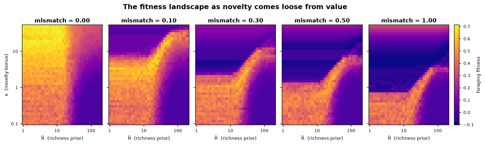
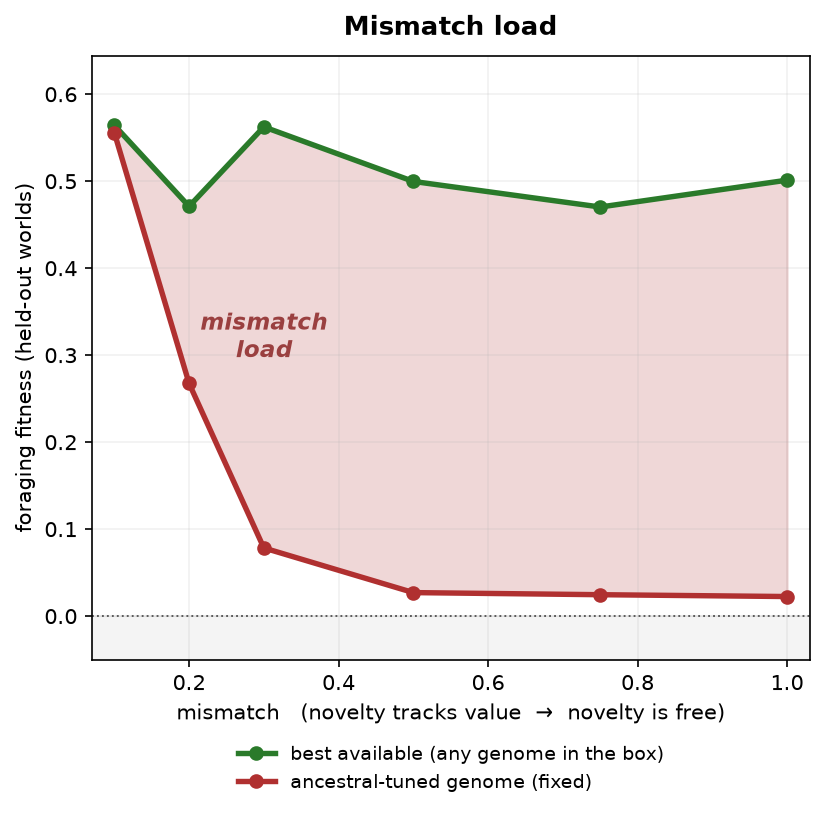

Information-Free Novelty

**Modelling evolutionary mismatch: information foraging and information-free novelty**

Nicholas Dunajski, supervised by James A. R. Marshall (University of Sheffield). SURE 2026.

Why is a social media feed so hard to put down? Foraging animals follow a simple rule,
the marginal value theorem: stay on a patch while it pays better than the environment's
average, then leave. For most of our history, something new usually meant something
worth having, so a pull toward novelty was a sensible shortcut. A feed serves up
endless novelty that is worth very little.

This project models a forager as a single neuron and maps how well every forager
strategy does as its world slides from **ancestral** (novelty tracks value) to
**modern** (novelty carries no information). The slide changes that one thing and
nothing else: the same patches, holding the same value, in the same places, found at
the same speed. Any change in which strategies do well is caused by novelty coming
loose from value.

The poster is in [docs/poster/Nico_Poster/main.tex](docs/poster/Nico_Poster/main.tex)
and the abstract in [docs/poster/abstract.txt](docs/poster/abstract.txt). It was made
with an earlier version of the model (see [Model versions](#model-versions)).

## The model

Each forager is one neuron with two variables: a membrane potential `V` and an
opportunity-cost signal `β`.

```
dV/dt = (I − (V − V_rest) − β) / τ_V
dβ/dt = (prox · (R̄ − I) − (1 − prox) · β) / τ_β
```

`I` is the scent the forager perceives, summed over nearby patches. Each patch
contributes its scent weighted by distance:

```
scent   = value + 0.5 · κ · novelty
novelty = (1 − m) · (value × freshness) + m
```

- `value` is the share of the patch's real value still left, from 1 down to 0.
- `freshness` falls from 1 to 0 as the patch gets sampled.
- `m` is the mismatch: 0 for the ancestral world, 1 for the modern one. It appears
  nowhere else in the model.
- `prox` is how close the forager is to a patch, from 1 on top of it to 0 in the open.

The world is the same at every `m`: 3 patches, each holding on average 40 units of
value, with the same scent reach and the same travel speed. A given seed lays out the
same map at every `m`, so the levels are compared on identical worlds.
`tests/test_pure_mismatch.py` checks this.

When `V` crosses threshold the neuron spikes, and each spike takes a bite of real value
from the patch. Firing needs a net drive `I − β` of at least 10. While the forager sits
on a patch, `β` grows only when the scent falls short of what the forager expects from
the environment (`I < R̄`). So the forager stops biting and wanders off once the scent
drops below the larger of 10 and `R̄`: the firing threshold ends the visit for foragers
with `R̄` below 10, and `β` ends it for foragers with `R̄` above 10. At `m = 0` an emptied
patch stops smelling novel, so its scent falls and the forager leaves. At `m = 1` it
still smells novel, so a forager with a large `κ` can keep firing on an empty patch.

Each forager has two heritable traits:

- `R̄`, how rich it expects the environment to be
- `κ`, how much novelty adds to a patch's pull

`τ_β` is fixed at 256 (about a quarter of a second, in the range measured for primate
prefrontal cortex). Fitness is the real value harvested per unit time, minus 0.3 times
the fraction of time spent engaged on a patch.

## Results

`scripts/compute_ladder.py` scores a grid of (`R̄`, `κ`) at 8 mismatch levels
(0, 0.05, 0.10, 0.20, 0.30, 0.50, 0.75, 1). Both axes are log-spaced (`R̄` from 1 to 200,
`κ` from 0.1 to 50), because both traits matter over orders of magnitude. Each cell is
the average over 8 simulated worlds, each run for 25,000 time units, and the file keeps
every world's score, so each cell also has a standard error.

The mismatch-load figure compares a genome tuned to the ancestral world (`m = 0.10`)
with the best genome in the biological box (`R̄ ≤ 25`, `κ ≤ 15`) at each level. Both are
re-scored on held-out worlds, so the best genome isn't flattered by having been picked
as the luckiest of many noisy cells.

The numbers below come from the 40 × 40 ladder in `results/ladder_res40/`. A cell's
standard error between worlds is typically 0.05.



When novelty tracks value (`m = 0`), strong novelty seeking does well, and the best `κ`
inside the box sits at the box's edge. As mismatch rises, high `κ` becomes the worst part
of the box. A sharp edge appears, with good strategies below it and fitness near or below
zero above it, and the edge sinks as `m` grows.

| mismatch `m`        | 0    | 0.05 | 0.10 | 0.20 | 0.30 | 0.50 | 0.75 | 1    |
|---------------------|------|------|------|------|------|------|------|------|
| best `κ` in the box | 14.0 | 11.9 | 5.4  | 2.1  | 1.5  | 1.3  | 0.49 | 0.58 |
| its fitness         | 0.69 | 0.71 | 0.67 | 0.64 | 0.61 | 0.59 | 0.56 | 0.54 |

Neighbouring cells at both ends score within noise of the best, so I read this as a 10-
to 25-fold fall in the best novelty bonus, most of it within the first 20% of mismatch.
The best `R̄` jumps around between levels because many values score about the same.

Best fitness falls far less than the best `κ` does. A forager that barely uses novelty
(the `κ = 0.1` row) scores 0.48–0.52 at every level, since the term that mismatch changes
is multiplied by `κ`. As mismatch rises, the best strategy sinks towards that floor.



The ancestral-tuned genome is `R̄ = 8.7, κ = 2.98`. On 32 held-out worlds:

| mismatch `m`     | 0.10  | 0.20  | 0.30  | 0.50  | 0.75  | 1     |
|------------------|-------|-------|-------|-------|-------|-------|
| ancestral-tuned  | 0.556 | 0.267 | 0.078 | 0.027 | 0.025 | 0.023 |
| best in the box  | 0.564 | 0.471 | 0.562 | 0.500 | 0.470 | 0.501 |
| mismatch load    | 0.008 | 0.204 | 0.484 | 0.473 | 0.445 | 0.478 |

In its own world the ancestral genome does as well as anything in the box. By `m = 0.3`
it scores close to zero, while the best available strategy still reaches about 0.5.

## Code

```
scripts/
  params.py                     neuron constants, τ_β, the ancestral-tuned genome
  world.py                      patches, their value and their scent
  agent.py                      the forager: V/β dynamics, spiking, movement
  fitness.py                    the fitness function; scores one landscape cell
  compute_ladder.py             the fitness landscape at each mismatch level
  render_landscapes.py          landscape filmstrip
  render_mismatch_load.py       mismatch load figure
  render_agent_single_patch.py  one forager, one patch
  render_forager_video.py       phone video of a forager
tests/test_pure_mismatch.py     checks that m changes nothing but the novelty term
results/
  ladder_res<N>/ladder_stack.npz  the landscapes: 8 mismatch levels × N × N
  poster_v1/                    the printed poster's ladder and figures (old model)
run_landscape.sh                SLURM job that computes a ladder
docs/references.md              papers behind each part of the model
```

## Reproducing

```bash
pip install -r requirements.txt

python tests/test_pure_mismatch.py

# The landscape on 32 cores (resumes if interrupted)
sbatch run_landscape.sh                                        # 10 × 10
sbatch --time=30:00:00 --export=ALL,RES=40 run_landscape.sh    # 40 × 40
python -m scripts.compute_ladder --summarise results/ladder_res40/ladder_stack.npz

# The figures
python -m scripts.render_landscapes --stack results/ladder_res40/ladder_stack.npz
python -m scripts.render_mismatch_load --stack results/ladder_res40/ladder_stack.npz
python -m scripts.render_agent_single_patch
python -m scripts.render_forager_video        # add --mismatch_index 1.0 for the modern world
```

The landscape was computed on the University of Sheffield's Stanage cluster (Linux,
Python 3.11). The simulation is chaotic over a 25,000-unit run, so floating-point
differences between platforms and library versions push individual runs apart.
Re-scoring cells on a Windows laptop gave values within about 0.04 of the stored ones
rather than identical values. That is about the size of a cell's between-world
standard error, which the ladder file records.

## Model versions

- **pure-v2** (this version). The mismatch changes only how novelty relates to value.
- **poster-v1** (outputs in `results/poster_v1/`; its code isn't in this repository).
  This is the printed poster. As well as the novelty term, moving towards the modern world also raised the
  patch count from 3 to 5, cut each patch's value from 40 to 8, narrowed and flickered
  the scent, and made travel up to 4 times faster. Those changes made the modern world
  easier, and they are mixed into its results; pure-v2 removes them.

## References

The main ones are Charnov (1976) for the leaving rule, Hayden et al. (2011) and
Kolling et al. (2012) for the neuron, Monosov (2024) for curiosity, and De Block &
Du Laing (2010) for supernormal stimuli. The full list is in
[docs/references.md](docs/references.md).

## Licence

MIT, see [LICENSE](LICENSE).
